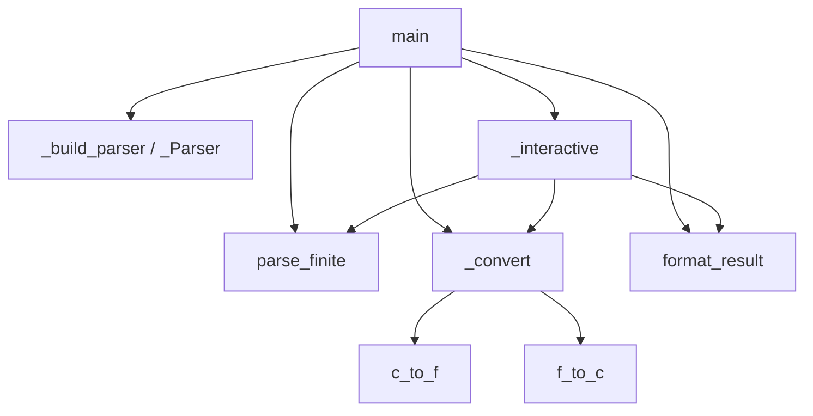
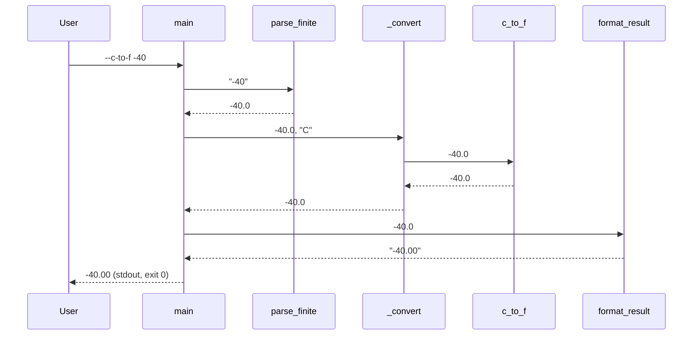

## Architecture Analysis

### System Overview
A single-module Python CLI (`temp_convert.py`). Pure conversion functions sit under a thin parsing and I/O layer. The streams are injected into `main`, so tests run it in-process.

### Architectural Style
Monolithic single script. Evidence: one module, standard library only, no packages or services.

### Component Relationships

Text fallback: `main` builds the parser, then either calls `_interactive` or runs the one-shot path. Both validate text with `parse_finite`, convert through `_convert` (which calls `c_to_f` or `f_to_c`), and print through `format_result`.

### Data Flow
Text input -> `parse_finite` (ASCII only, no underscores, finite float) -> `_convert` (rejects a non-finite result) -> `format_result` (2 decimals, `-0.00` becomes `0.00`) -> stdout. Errors go to stderr.

### Key Design Decisions
- Streams injected into `main` and `_interactive` for testability.
- `_Parser` raises `_UsageError` instead of exiting, so `main` returns exit codes (2 for usage, 1 for a bad value).
- Strict number parsing rejects `nan`, `inf`, underscores, and non-ASCII digits.

### Improvement Opportunities
See `code-quality-assessment.md`.

## Interaction Diagrams

One-shot conversion, `--c-to-f -40`:

Text fallback: the CLI value `-40` is parsed to -40.0, converted to -40.0 (-40 * 9/5 + 32), formatted as `-40.00`, and written to stdout with exit 0.
